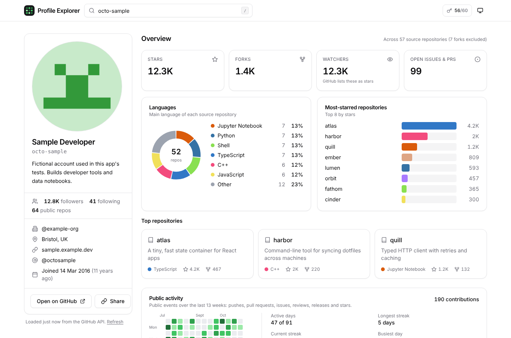
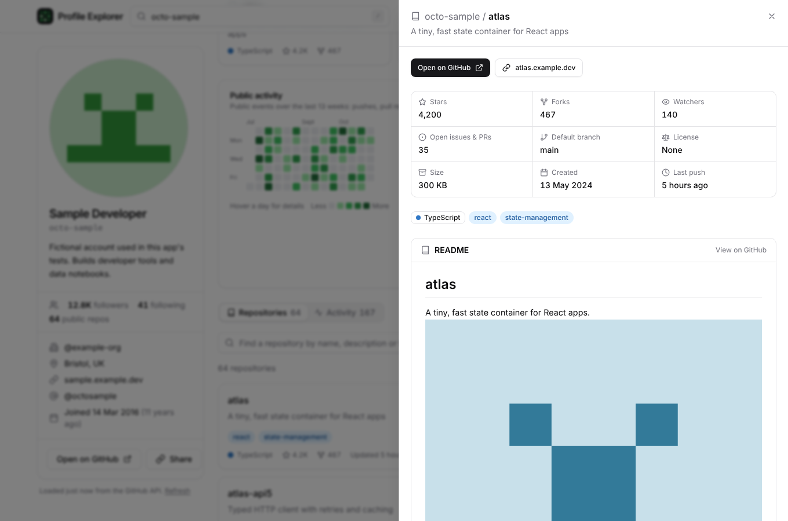
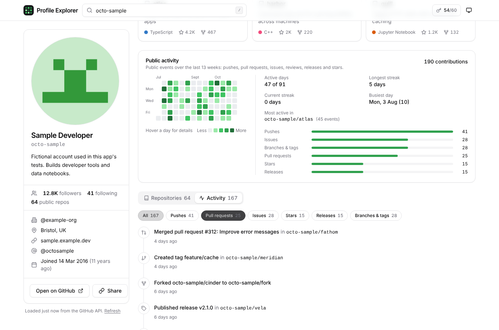
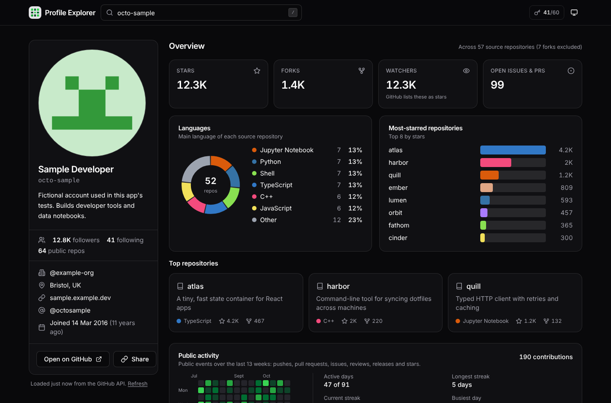
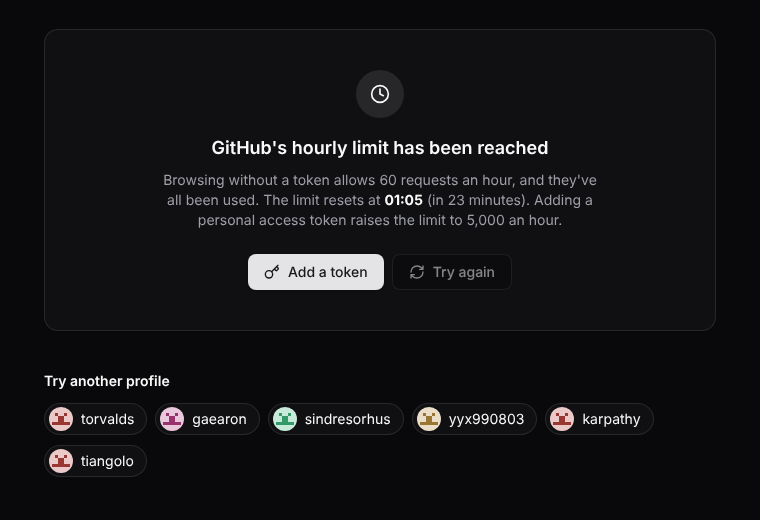
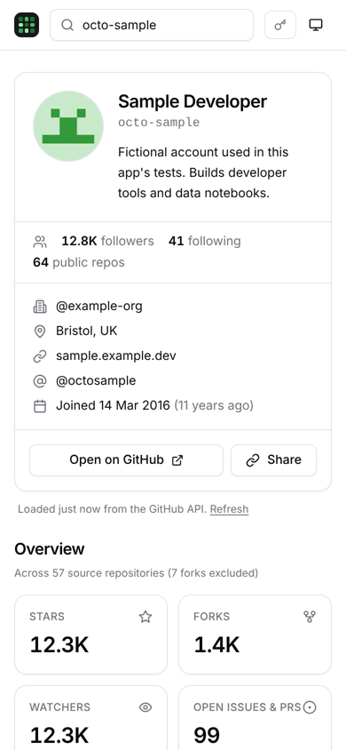

# GitHub Profile Explorer


Search any GitHub username and see their profile, repositories, languages, stars and recent public activity on one page. Everything is loaded live from GitHub's public REST API, straight from your browser.

**Live app: [ranzith1282000-beep.github.io/github-profile-explorer](https://ranzith1282000-beep.github.io/github-profile-explorer/)**. Try it with [`?user=torvalds`](https://ranzith1282000-beep.github.io/github-profile-explorer/?user=torvalds).



<sub>Screenshots use a fictional sample account from the test fixtures, so every chart has data to show.</sub>

## Features

- **Profile search.** Enter a username, an `@handle` or a profile link. Each profile gets a shareable URL (`?user=…`), and the browser's back button works. Press <kbd>/</kbd> or <kbd>Ctrl</kbd>+<kbd>K</kbd> anywhere to search.
- **Profile card.** Avatar, name, bio, company, location, website, X/Twitter, followers, following, public repo count and join date.
- **Stats overview.** Total stars, forks, watchers and open issues across the user's own repositories (forks excluded), a language donut, a most-starred bar chart and their top three repositories.
- **Repository browser.** Search by name, description or topic. Sort by stars, last push or name, and filter by language or type (sources, forks, archived). Each repository opens a drawer with its details and its rendered README.
- **Activity.** A GitHub-style heatmap of the last 13 weeks, with streaks, the busiest day and the most active repository. Below it, a feed of pushes, pull requests, issues, stars, releases and branches, filterable by type.
- **Explore and history.** Suggested profiles to try, plus your recent searches kept in this browser, each re-run with one click.
- **Every state handled.** Loading skeletons, empty states, "user not found", network errors, and a rate-limit screen that shows when the limit resets.
- **Light and dark themes.** Follows your system setting, or set it yourself with the toggle. Works on phones, with keyboard navigation and screen-reader labels throughout.

| Repository drawer with README | Activity feed and heatmap |
|---|---|
|  |  |

| Dark theme | Rate-limit state | Phone |
|---|---|---|
|  |  |  |

## How it works

```
src/
├── lib/
│   ├── github.ts      API client: rate-limit tracking, typed errors, pagination, username parsing
│   ├── stats.ts       totals, language shares, heatmap grid, streaks
│   ├── events.ts      turns raw public events into readable activity
│   ├── repos.ts       repository search, filter and sort
│   ├── readme.ts      Markdown to sanitised HTML, with relative links fixed
│   └── format.ts      compact numbers, relative times
├── hooks/             profile loading, theme, token, recent searches, ?user= routing
└── components/        UI, with shadcn/ui-style primitives in components/ui
```

A profile takes **3 to 7 API requests**: the user, then their repositories (100 per page, up to 3 pages) and their events (up to 3 pages) in parallel. If only the events fail, the profile still loads. Opening a repository costs 2 more requests: its full record and its README.

### Things I learned about GitHub's API

- **`watchers_count` isn't watchers.** In repository lists GitHub sets it to the star count, for historical reasons. The real number is `subscribers_count`, which only comes from the single-repository endpoint, so the drawer fetches it there. The overview card says so.
- **Public events no longer include commits.** Push events now carry only the branch and head commit, with no commit list or count. So the heatmap counts each push once, and counts commits only for older events that still have them.
- **The events API has hard limits.** It returns at most 300 events from the last 90 days. The heatmap covers 13 weeks to match, and warns when the 300-event cap cuts off earlier days.
- **README links are relative to the repository.** Images are rewritten to `raw.githubusercontent.com` and links to the file on GitHub, the way GitHub renders them. The HTML is sanitised with DOMPurify before display.
- **Open issues include pull requests.** The card is labelled "Open issues & PRs" for that reason.

## Rate limits and tokens

Without a token, GitHub allows **60 requests an hour** per IP address. The header shows how many you have left. To raise this to 5,000, add a [fine-grained personal access token](https://github.com/settings/personal-access-tokens/new) with *Public repositories (read-only)* access and no other permissions. The token is sent only to `api.github.com`. It stays in memory for the visit, or in your browser's local storage if you tick "Remember on this device".

## Run it locally

```bash
git clone https://github.com/ranzith1282000-beep/github-profile-explorer.git
cd github-profile-explorer
npm install
npm run dev        # http://localhost:5173
npm test           # unit tests (Vitest)
npm run typecheck
npm run build      # static site in dist/
```

Every push to `main` runs type checks, tests and a build, then deploys to GitHub Pages.

## Tech stack

React 19, TypeScript, Vite, Tailwind CSS 4, shadcn/ui-style components (class-variance-authority, tailwind-merge), marked, DOMPurify, Vitest and GitHub Actions. Charts are hand-built SVG, and icons follow the Lucide style.

Not affiliated with GitHub. Released under the [MIT licence](LICENSE).
